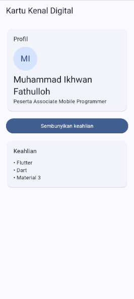

# Modul 1: Platform Operating System dan Bahasa Pemrograman Mobile

**Durasi:** 09.00 to 10.00

## Tujuan Pembelajaran

1. Membandingkan ekosistem Android dan iOS.
2. Menjelaskan arsitektur Flutter dan peran Dart.
3. Membuat dan menjalankan aplikasi Flutter pertama.

## 1. Ekosistem Mobile

| Aspek | Android | iOS |
|---|---|---|
| Pengembang | Google | Apple |
| IDE resmi | Android Studio | Xcode (hanya di macOS) |
| Bahasa native | Kotlin, Java | Swift |
| Framework UI native | Jetpack Compose, XML Views | SwiftUI, UIKit |
| Distribusi | Google Play Store | App Store |

## 2. Posisi Flutter

Flutter adalah framework UI open source dari Google untuk membangun aplikasi Android, iOS, web, dan desktop dari satu basis kode. Flutter menggunakan bahasa **Dart**.

Arsitektur Flutter terdiri atas tiga lapisan:

1. **Framework** (Dart): widget, layout, animasi, dan state.
2. **Engine** (C++): rendering grafis melalui Impeller, pengelolaan teks, dan integrasi platform.
3. **Embedder** platform: menghubungkan engine dengan sistem operasi Android atau iOS.

Flutter tidak menggunakan komponen native untuk setiap elemen UI. Seluruh tampilan digambar oleh engine Flutter, sehingga tampilan relatif konsisten di kedua platform.

## 3. Dart Essentials

```dart
void main() {
  // Variabel dan tipe data
  String nama = 'Peserta';
  int umur = 25;
  final kota = 'Bandung'; // nilai tidak dapat diubah setelah diberikan
  const pi = 3.14159;     // nilai konstan saat kompilasi

  // Null safety
  String? catatan; // boleh null
  print(catatan ?? 'Tidak ada catatan');

  // Fungsi
  print(sapa(nama));

  // Class
  final orang = Orang(nama: nama, umur: umur);
  print(orang.perkenalan());

  // Async dengan Future
  ambilData().then((hasil) => print(hasil));
}

String sapa(String nama) => 'Halo, $nama';

class Orang {
  final String nama;
  final int umur;

  Orang({required this.nama, required this.umur});

  String perkenalan() => 'Saya $nama, berumur $umur tahun.';
}

Future<String> ambilData() async {
  await Future.delayed(const Duration(seconds: 1));
  return 'Data berhasil diambil';
}
```

## 4. Widget dan Widget Tree

Segala sesuatu di layar adalah widget: teks, tombol, layout, dan bahkan aplikasi itu sendiri. Widget tersusun dalam pohon (widget tree).

| Jenis | Keterangan | Contoh |
|---|---|---|
| `StatelessWidget` | Tampilan tetap, tidak menyimpan state | `Text`, `Icon` |
| `StatefulWidget` | Tampilan dapat berubah, menyimpan state di class `State` | Counter, form input |

### Contoh StatelessWidget

```dart
import 'package:flutter/material.dart';

class HaloFlutter extends StatelessWidget {
  const HaloFlutter({super.key});

  @override
  Widget build(BuildContext context) {
    return const Text('Halo Flutter!');
  }
}
```

### Contoh StatefulWidget

```dart
import 'package:flutter/material.dart';

class CounterWidget extends StatefulWidget {
  const CounterWidget({super.key});

  @override
  State<CounterWidget> createState() => _CounterWidgetState();
}

class _CounterWidgetState extends State<CounterWidget> {
  int _counter = 0;

  void _tambah() {
    setState(() {
      _counter++;
    });
  }

  @override
  Widget build(BuildContext context) {
    return Column(
      mainAxisSize: MainAxisSize.min,
      children: [
        Text('Nilai counter: $_counter'),
        ElevatedButton(
          onPressed: _tambah,
          child: const Text('Tambah'),
        ),
      ],
    );
  }
}
```

### Siklus Hidup State

| Method | Keterangan |
|---|---|
| `initState()` | Dipanggil sekali saat widget dibuat. Cocok untuk inisialisasi controller. |
| `didChangeDependencies()` | Dipanggil setelah `initState` dan saat dependensi berubah. |
| `build()` | Membangun tampilan. Sebaiknya tidak memiliki efek samping. |
| `dispose()` | Dipanggil saat widget dihapus. Lepaskan controller dan stream di sini. |

## 5. Membuat Proyek Pertama

```bash
flutter create aplikasi_pertama
cd aplikasi_pertama
flutter run
```

Ganti isi `lib/main.dart`:

```dart
import 'package:flutter/material.dart';

void main() {
  runApp(const AplikasiPertama());
}

class AplikasiPertama extends StatelessWidget {
  const AplikasiPertama({super.key});

  @override
  Widget build(BuildContext context) {
    return MaterialApp(
      debugShowCheckedModeBanner: false,
      theme: ThemeData(
        colorSchemeSeed: Colors.indigo,
        useMaterial3: true,
      ),
      home: const Scaffold(
        body: Center(
          child: Text(
            'Halo, Peserta Pelatihan',
            style: TextStyle(fontSize: 20),
          ),
        ),
      ),
    );
  }
}
```

## Contoh hasil

Tangkapan layar hasil menjalankan proyek modul 1 (sama dengan README proyek dan slide).



## Latihan

1. Jalankan aplikasi pada emulator atau perangkat fisik.
2. Ubah nilai `colorSchemeSeed`, lalu tekan `r` di terminal untuk hot reload.
3. Ubah teks, lalu tekan `R` untuk hot restart. Bandingkan hasilnya dengan hot reload.
4. Buat `StatefulWidget` counter dan tampilkan di layar.
