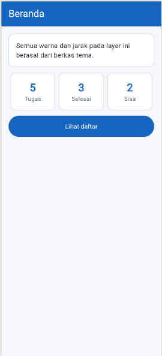
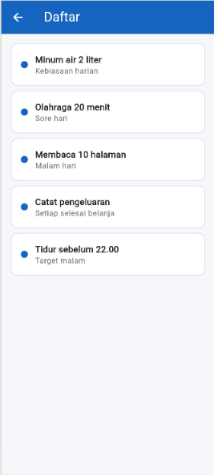

# Modul 2: Desain dengan Figma dan Stitch, Gaya, dan Implementasi dengan AI

**Durasi:** 10.00 to 12.00

**Unit kompetensi BNSP:** J.612000.007.01

by [Muhammad Ikhwan Fathulloh](https://one.nocturnailed.com/)

Modul ini sejajar dengan jalur React Native (`reactnative/docs/hari-1/02-figma-stitch-dan-gaya.md`). Isi tata letak, navigasi, dan form Flutter ada di [Mobile Interface](02-mobile-interface.md) dan dipakai sebagai bahan bagian implementasi.

## Pengantar

Sebelum menulis banyak kode, kita memutuskan seperti apa aplikasinya. Dua jam ini memakai alat desain modern: Google Stitch untuk rancangan awal dari prompt, dan Figma untuk merapikannya dengan Auto Layout dan variable. Variable itu menjadi token yang kita pindahkan ke `lib/theme/tema.dart`, sehingga warna, jarak, dan font hanya ditulis di satu tempat.

## Tujuan Pembelajaran

1. Merancang layar di Figma dengan Auto Layout dan variable.
2. Memakai Google Stitch untuk membuat rancangan awal dari prompt.
3. Membandingkan beberapa gaya desain.
4. Mengubah token desain menjadi `lib/theme/tema.dart`.
5. Meminta AI menerapkan gaya ke aplikasi dan meninjau hasilnya.

## 1. Alur dari ide ke aplikasi

- Mulai dari kebutuhan pengguna dan daftar layar, bukan dari warna.
- **Google Stitch** membuat rancangan awal dari prompt, lalu diperbaiki lewat chat.
- **Figma** merapikan rancangan: Auto Layout, komponen, dan **variable**. Berkas contoh pelatihan: https://www.figma.com/design/grYqOsULGfzYsDrtIjmjRL
- Variable menjadi **token** di `lib/theme/tema.dart`. Widget memakai token, bukan angka langsung.
- AI membantu menerapkan gaya ke kode. Manusia meninjau hasilnya.

## 2. Google Stitch

- Alat dari Google Labs di `stitch.withgoogle.com`: teks atau gambar menjadi rancangan antarmuka dan kode front-end.
- Perbaiki dengan chat, ubah tema, lalu salin atau ekspor ke Figma sebagai layer yang bisa diedit.
- Hasil Stitch adalah **titik awal**. Rapikan struktur dan token sebelum menjadi kode aplikasi.
- Fitur dan menu berubah cepat. Cek tampilan terbaru sebelum sesi dimulai.

## 3. Figma untuk pengembang

| Fitur | Fungsi | Padanan di Flutter |
|---|---|---|
| Auto Layout | Isi menyesuaikan ukuran dan jarak | `Row`, `Column`, `Padding`, `SizedBox` |
| Component | Elemen yang dipakai ulang | Widget sendiri, mis. `Kartu` |
| Variable | Warna, spasi, radius, font | Kelas `Tema` di `lib/theme/tema.dart` |
| Dev Mode | Melihat ukuran dan nilai untuk pengembang | Nilai di `Tema` dan `TextStyle` |
| Prototype | Mengklik antar layar | Navigasi `go_router` |

## 4. Beberapa gaya desain

| Gaya | Ciri | Cocok untuk |
|---|---|---|
| Material 3 | Warna dari seed, tombol terisi, ikon jelas | Aplikasi Android umum |
| iOS (HIG) | Sudut membulat, banyak ruang kosong, teks tebal tipis | Aplikasi dengan nuansa iOS |
| Minimal | Sedikit warna, banyak spasi, tanpa dekorasi | Alat kerja dan catatan |
| Gelap | Latar gelap, kontras dijaga | Dipakai malam, hemat baterai layar OLED |

## 5. Token menjadi tema.dart

Setiap variable Figma punya padanan di sini. Mengubah satu nilai mengubah seluruh aplikasi. Berkas `lib/theme/tema.dart` (ringkasan):

```dart
import 'package:flutter/material.dart';

/// Token desain. Nama dan nilainya sama dengan variable di Figma.
class Tema {
  Tema._();

  // Warna
  static const utama = Color(0xFF1565C0);
  static const latar = Color(0xFFF5F7FB);
  static const kartu = Color(0xFFFFFFFF);
  static const teks = Color(0xFF1B1F27);
  static const abu = Color(0xFF5F6B7A);
  static const garis = Color(0xFFCFD6E0);

  // Spasi, radius, dan font
  static const spasiMd = 12.0;
  static const spasiLg = 16.0;
  static const radiusMd = 12.0;
  static const fontIsi = 15.0;

  /// Target sentuh minimal sekitar 48 dp.
  static const tinggiTombol = 48.0;
}
```

## 6. Token diterapkan di widget

Widget membaca nilai dari `Tema`. Tidak ada angka warna mentah di layar. Contoh kartu:

```dart
Card(
  color: Tema.kartu,
  shape: RoundedRectangleBorder(
    borderRadius: BorderRadius.circular(Tema.radiusMd),
    side: const BorderSide(color: Tema.garis),
  ),
  child: Padding(
    padding: const EdgeInsets.all(Tema.spasiLg),
    child: Text('Catatan', style: TextStyle(fontSize: Tema.fontIsi, color: Tema.teks)),
  ),
);
```

## 7. Prompt AI untuk menerapkan gaya

- Sertakan **konteks**: tumpukan teknologi (Flutter, Dart), berkas `lib/theme/tema.dart`.
- Sertakan **tujuan**: gaya apa, layar mana, dan batasannya (jangan ubah logika).
- Sertakan **bukti desain**: tangkapan layar Figma atau nilai variable.
- Setelah AI mengubah kode: jalankan `flutter analyze` dan `flutter test`, lalu lihat hasilnya di perangkat.
- Jangan menempelkan rahasia (token, kata sandi) ke alat AI.

## Contoh hasil

Tangkapan layar hasil menjalankan proyek modul 2 (sama dengan README proyek dan slide).





## Latihan

1. Buka berkas Figma contoh, ubah `warna/utama`, lalu samakan nilainya di `Tema.utama`.
2. Buat rancangan layar Catatan di Stitch, ekspor ke Figma, dan rapikan dengan Auto Layout.
3. Minta AI mengubah gaya aplikasi menjadi gelap memakai prompt berkonteks, lalu tinjau perbedaannya.

## Proyek Modul: Redesain Dua Layar dengan Token

Ambil rancangan dua layar (Beranda dan Daftar) dari Stitch atau Figma, jadikan variable menjadi token, lalu implementasikan di aplikasi. Boleh meminta bantuan AI, tetapi hasilnya harus Anda tinjau.

Brief lengkap, kriteria penerimaan, dan rubrik: [shared/docs/proyek](../../../shared/docs/proyek/modul-2-redesain-dua-layar-dengan-token.md).

## Peta Kompetensi BNSP

Unit **J.612000.007.01**. Elemen yang dinilai:

- Menentukan alat perancangan antarmuka
- Memilih informasi yang ditampilkan per layar
- Membuat aksi dan desain estetis per layar

Bukti pada pelatihan ini: berkas Figma (variable dan 5 layar), `lib/theme/tema.dart`, dan `lib/pages/` untuk layar aplikasi.

Praktik langkah demi langkah: [hands-on Hari 1](../hands-on/hari-1.md).
