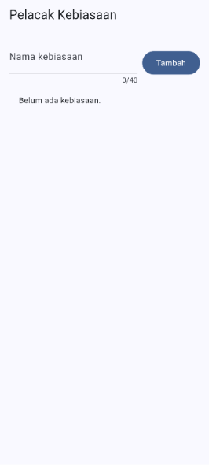
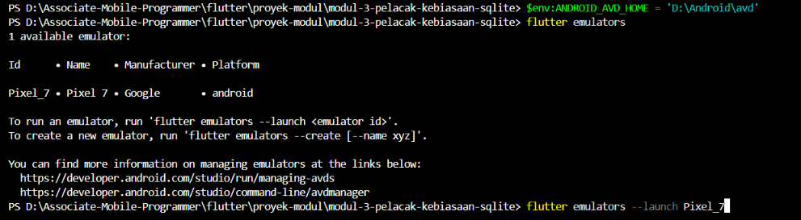
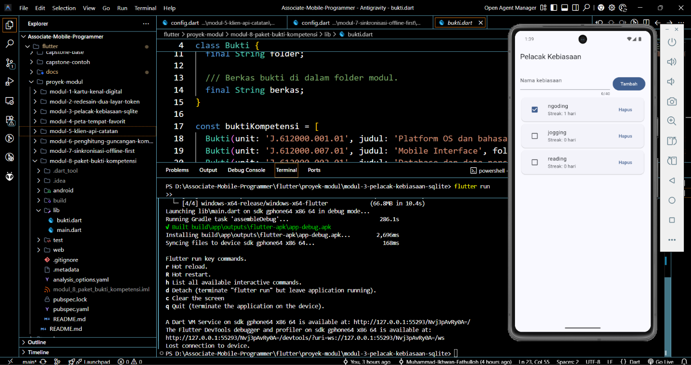

# Modul 3: Perancangan Database dan Data Persistence pada Mobile

**Durasi:** 13.00 to 15.00

## Tujuan Pembelajaran

1. Memilih metode penyimpanan lokal yang sesuai kebutuhan.
2. Merancang tabel untuk aplikasi mobile.
3. Mengimplementasikan operasi CRUD dengan `sqflite`.
4. Memahami konsep offline-first dan sinkronisasi dengan server.

## 1. Pilihan Penyimpanan Lokal

| Metode | Package | Tipe data | Contoh penggunaan |
|---|---|---|---|
| Key-value | `shared_preferences` | Pasangan key-value sederhana | Tema, status onboarding |
| Penyimpanan aman | `flutter_secure_storage` | Key-value terenkripsi | Token akses |
| SQLite | `sqflite` | Relasional | Data terstruktur dengan relasi dan kueri |
| Berkas | `path_provider` | Teks atau biner | Gambar, cache, dokumen |

## 2. Perancangan Tabel

Langkah perancangan:

1. Identifikasi entitas, misalnya `notes` dan `categories`.
2. Tentukan atribut dan tipenya (`INTEGER`, `TEXT`, `REAL`).
3. Tentukan *primary key* dan kolom wajib (`NOT NULL`).
4. Tentukan relasi, misalnya *foreign key* dari `notes` ke `categories`.
5. Tambahkan indeks pada kolom yang sering dikueri.

Contoh rancangan:

```
notes
├── id          INTEGER  PRIMARY KEY AUTOINCREMENT
├── title       TEXT     NOT NULL
├── content     TEXT     NOT NULL
├── latitude    REAL
├── longitude   REAL
├── updated_at  INTEGER  NOT NULL
└── sync_status TEXT     NOT NULL DEFAULT 'PENDING'
```

## 3. Konfigurasi Dependensi

```yaml
dependencies:
  sqflite: ^2.3.3 # sesuaikan dengan versi stabil terbaru
  path: ^1.9.0
```

Jalankan `flutter pub get`.

## 4. Model Data

```dart
// lib/models/note.dart
class Note {
  final int? id;
  final String title;
  final String content;
  final double? latitude;
  final double? longitude;
  final int updatedAt;
  final String syncStatus;

  Note({
    this.id,
    required this.title,
    required this.content,
    this.latitude,
    this.longitude,
    int? updatedAt,
    this.syncStatus = 'PENDING',
  }) : updatedAt = updatedAt ?? DateTime.now().millisecondsSinceEpoch;

  Map<String, Object?> toMap() {
    return {
      'id': id,
      'title': title,
      'content': content,
      'latitude': latitude,
      'longitude': longitude,
      'updated_at': updatedAt,
      'sync_status': syncStatus,
    };
  }

  factory Note.fromMap(Map<String, Object?> map) {
    return Note(
      id: map['id'] as int?,
      title: map['title'] as String,
      content: map['content'] as String,
      latitude: map['latitude'] as double?,
      longitude: map['longitude'] as double?,
      updatedAt: map['updated_at'] as int,
      syncStatus: map['sync_status'] as String,
    );
  }
}
```

## 5. Database Helper

```dart
// lib/data/app_database.dart
import 'package:path/path.dart';
import 'package:sqflite/sqflite.dart';

class AppDatabase {
  static const _namaDatabase = 'app_database.db';
  static const _versiDatabase = 1;

  static Database? _database;

  static Future<Database> get instance async {
    if (_database != null) return _database!;

    final path = join(await getDatabasesPath(), _namaDatabase);
    _database = await openDatabase(
      path,
      version: _versiDatabase,
      onConfigure: (db) async {
        await db.execute('PRAGMA foreign_keys = ON');
      },
      onCreate: (db, version) async {
        await db.execute('''
          CREATE TABLE notes (
            id INTEGER PRIMARY KEY AUTOINCREMENT,
            title TEXT NOT NULL,
            content TEXT NOT NULL,
            latitude REAL,
            longitude REAL,
            updated_at INTEGER NOT NULL,
            sync_status TEXT NOT NULL DEFAULT 'PENDING'
          )
        ''');
        await db.execute(
          'CREATE INDEX idx_notes_updated_at ON notes(updated_at)',
        );
      },
    );
    return _database!;
  }
}
```

## 6. Repository (CRUD)

```dart
// lib/data/note_repository.dart
import 'package:sqflite/sqflite.dart';
import '../models/note.dart';
import 'app_database.dart';

class NoteRepository {
  Future<List<Note>> getAll() async {
    final db = await AppDatabase.instance;
    final rows = await db.query('notes', orderBy: 'updated_at DESC');
    return rows.map(Note.fromMap).toList();
  }

  Future<int> insert(Note note) async {
    final db = await AppDatabase.instance;
    final values = note.toMap()..remove('id');
    return db.insert('notes', values, conflictAlgorithm: ConflictAlgorithm.abort);
  }

  Future<int> update(Note note) async {
    final db = await AppDatabase.instance;
    return db.update(
      'notes',
      note.toMap(),
      where: 'id = ?',
      whereArgs: [note.id],
    );
  }

  Future<int> delete(int id) async {
    final db = await AppDatabase.instance;
    return db.delete('notes', where: 'id = ?', whereArgs: [id]);
  }
}
```

Parameter `whereArgs` mencegah SQL injection. Jangan menyusun kueri dengan menggabungkan input pengguna ke dalam string SQL.

## 7. State dengan ChangeNotifier

```dart
// lib/blocs/note_controller.dart
import 'package:flutter/foundation.dart';
import '../data/note_repository.dart';
import '../models/note.dart';

class NoteController extends ChangeNotifier {
  NoteController(this._repository);

  final NoteRepository _repository;
  List<Note> _notes = [];
  bool _isLoading = false;

  List<Note> get notes => List.unmodifiable(_notes);
  bool get isLoading => _isLoading;

  Future<void> load() async {
    _isLoading = true;
    notifyListeners();
    try {
      _notes = await _repository.getAll();
    } finally {
      _isLoading = false;
      notifyListeners();
    }
  }

  Future<void> addNote(String title, String content) async {
    await _repository.insert(Note(title: title, content: content));
    await load();
  }

  Future<void> deleteNote(int id) async {
    await _repository.delete(id);
    await load();
  }
}
```

## 8. Menampilkan Data

```dart
// lib/pages/note_list_page.dart
import 'package:flutter/material.dart';
import '../blocs/note_controller.dart';

class NoteListPage extends StatelessWidget {
  final NoteController controller;

  const NoteListPage({super.key, required this.controller});

  @override
  Widget build(BuildContext context) {
    return ListenableBuilder(
      listenable: controller,
      builder: (context, _) {
        if (controller.isLoading) {
          return const Center(child: CircularProgressIndicator());
        }
        if (controller.notes.isEmpty) {
          return const Center(child: Text('Belum ada catatan'));
        }
        return ListView.separated(
          padding: const EdgeInsets.all(16),
          itemCount: controller.notes.length,
          separatorBuilder: (_, __) => const SizedBox(height: 8),
          itemBuilder: (context, index) {
            final note = controller.notes[index];
            return Card(
              child: ListTile(
                title: Text(note.title),
                subtitle: Text(note.content),
                trailing: IconButton(
                  icon: const Icon(Icons.delete_outline),
                  onPressed: () => controller.deleteNote(note.id!),
                ),
              ),
            );
          },
        );
      },
    );
  }
}
```

Muat data saat layar pertama kali dibuka, misalnya dengan memanggil `controller.load()` di `initState` pada layar induk.

## 9. Konsep Offline-First dan Sinkronisasi

Pola offline-first menulis data ke database lokal terlebih dahulu, lalu menyinkronkannya ke server di latar belakang.

Komponen utama:

1. **Kolom `sync_status`** untuk menandai data (`PENDING`, `SYNCED`, `FAILED`).
2. **Antrean unggahan** yang dijalankan saat koneksi tersedia, misalnya dengan `connectivity_plus`.
3. **Resolusi konflik**, misalnya *last-write-wins* berdasarkan `updated_at`, atau nomor versi dari server.

```dart
Future<List<Note>> getPendingSync() async {
  final db = await AppDatabase.instance;
  final rows = await db.query(
    'notes',
    where: 'sync_status = ?',
    whereArgs: ['PENDING'],
  );
  return rows.map(Note.fromMap).toList();
}
```

## Contoh hasil

Tangkapan layar hasil menjalankan proyek modul 3 (sama dengan README proyek dan slide).








## Latihan

1. Tambahkan fitur edit catatan dengan `NoteRepository.update`.
2. Buat tabel `categories` dan kolom `category_id` pada `notes` sebagai *foreign key*.
3. Tampilkan jumlah catatan dengan `Future` dan `FutureBuilder`.
