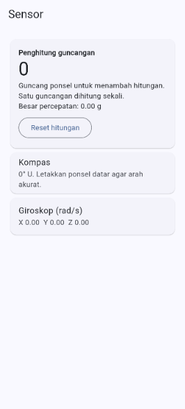

# Modul 6: Mobile Sensor dan Spesifikasi Teknis Mobile Computing

Waktu: 10.00 to 12.00 (Hari 2)

## Tujuan Pembelajaran

Setelah modul ini, peserta mampu:

1. Menyebutkan jenis sensor yang umum ada pada perangkat mobile dan kegunaannya.
2. Menjelaskan spesifikasi teknis perangkat: prosesor, memori, layar, baterai, dan konektivitas.
3. Membaca data sensor di aplikasi Flutter.
4. Menampilkan informasi perangkat di aplikasi Flutter.
5. Memahami hubungan spesifikasi perangkat dengan desain aplikasi.

## 1. Jenis Sensor pada Perangkat Mobile

| Sensor | Mengukur | Contoh penggunaan |
|---|---|---|
| Accelerometer | Percepatan pada sumbu x, y, z | Deteksi goyangan, orientasi, langkah |
| Gyroscope | Kecepatan rotasi | Permainan, kamera stabil, navigasi |
| Magnetometer | Medan magnet (kompas) | Arah mata angin |
| Proximity | Jarak objek di depan layar | Mematikan layar saat ditempelkan ke telinga |
| Light | Intensitas cahaya | Kecerahan layar otomatis |
| Barometer | Tekanan udara | Perkiraan ketinggian |
| GPS | Posisi geografis | Peta dan navigasi (lihat modul 4 Hari 1) |

Tidak semua perangkat memiliki semua sensor. Periksa ketersediaan sensor sebelum menggunakannya, dan sediakan alternatif jika sensor tidak ada.

## 2. Spesifikasi Teknis untuk Mobile Computing

| Komponen | Yang perlu diperhatikan | Dampak pada aplikasi |
|---|---|---|
| Prosesor (SoC) | Jumlah inti dan frekuensi | Kecepatan animasi dan pengolahan data |
| Memori (RAM) | Kapasitas | Jumlah proses latar belakang dan ukuran data di memori |
| Penyimpanan | Kapasitas dan jenis (UFS, eMMC) | Kecepatan baca dan tulis database |
| Layar | Ukuran, resolusi, kerapatan piksel, refresh rate | Tata letak responsif dan kehalusan animasi |
| Baterai | Kapasitas dan daya tahan | Frekuensi pembacaan sensor dan GPS |
| Konektivitas | Wi-Fi, Bluetooth, NFC, seluler | Jenis layanan yang dapat dipakai |
| Sistem operasi | Versi Android atau iOS | Fitur API yang tersedia |

Aplikasi yang boros baterai biasanya membaca sensor atau GPS terlalu sering. Atur frekuensi pembacaan sesuai kebutuhan.

## 3. Membaca Data Sensor di Flutter

Package `sensors_plus` menyediakan stream data dari accelerometer, gyroscope, dan magnetometer.

```dart
import 'dart:async';
import 'package:sensors_plus/sensors_plus.dart';

final StreamSubscription<AccelerometerEvent> langganan =
    accelerometerEventStream().listen((event) {
  // event.x, event.y, event.z dalam m/s2
});

// Wajib dibatalkan saat layar ditutup
langganan.cancel();
```

Prinsip penting:

- Selalu batalkan (`cancel`) langganan sensor di `dispose` untuk menghemat baterai.
- Gunakan `setState` hanya saat nilai berubah cukup berarti, agar UI tidak dibangun ulang terus-menerus.

## 4. Informasi Perangkat di Flutter

Package `device_info_plus` membaca informasi perangkat dari sistem operasi.

```dart
import 'package:device_info_plus/device_info_plus.dart';

final info = await DeviceInfoPlugin().androidInfo;
print(info.brand);            // contoh: samsung
print(info.model);            // contoh: SM-A057G
print(info.version.release);  // versi Android, contoh: 14
print(info.version.sdkInt);   // API level, contoh: 34
print(info.supportedAbis);    // arsitektur CPU, contoh: arm64-v8a
```

`device_info_plus` tidak membaca semua spesifikasi (misalnya kapasitas RAM atau kapasitas baterai secara langsung). Untuk nilai tersebut, gunakan informasi versi dan model untuk mencari data resmi pabrikan.

## 5. Dampak pada Desain Aplikasi

- Gunakan `LayoutBuilder` dan `MediaQuery` agar tampilan menyesuaikan ukuran layar.
- Pilih animasi yang ringan pada perangkat kelas bawah.
- Periksa sensor sebelum fitur yang bergantung padanya ditampilkan.
- Simpan hanya data yang diperlukan dari sensor, bukan seluruh aliran data.

## Diskusi

1. Sensor apa yang dibutuhkan aplikasi pencatat olahraga?
2. Mengapa membaca accelerometer setiap milidetik dapat menguras baterai?
3. Apa yang harus dilakukan aplikasi jika perangkat tidak memiliki sensor gyroscope?

## Referensi

- Panduan sensors_plus: https://pub.dev/packages/sensors_plus
- Panduan device_info_plus: https://pub.dev/packages/device_info_plus
- Panduan hands-on: [docs/hands-on/hari-2.md](../hands-on/hari-2.md), Step 2 dan Step 3
- Slide modul: [slides/hari-2-modul-6-mobile-sensor-spesifikasi.html](../../slides/hari-2-modul-6-mobile-sensor-spesifikasi.html)

## Contoh hasil

Tangkapan layar hasil menjalankan proyek modul 6 (sama dengan README proyek dan slide).



