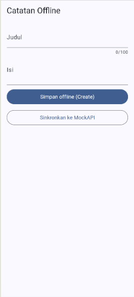

# Modul 7: API Lanjutan: CRUD, Token, Sinkronisasi, dan Keamanan Jaringan

**Durasi:** 13.00 to 15.00 (Hari 2, sesi lanjutan)

**Unit kompetensi BNSP:** J.612000.025.01 dan J.612000.008.01

by [Muhammad Ikhwan Fathulloh](https://one.nocturnailed.com/)

Modul ini sejajar dengan jalur React Native (`reactnative/docs/hari-2/07-api-lanjutan-sinkronisasi.md`). Bacaan pendukung: [Keamanan Komunikasi Mobile](07-keamanan-komunikasi-mobile.md) dan [Mobile Cellular Network](05-mobile-cellular-network.md).

## Pengantar

Aplikasi yang baik tetap bekerja saat sinyal hilang. Catatan disimpan di ponsel dengan status `PENDING`, lalu dikirim ke server saat koneksi tersedia dan berubah menjadi `SYNCED`. Token login disimpan di penyimpanan aman, dan semua permintaan memakai HTTPS. Modul ini menyatukan CRUD, token, sinkronisasi, dan keamanan jaringan dalam satu alur.

## Tujuan Pembelajaran

1. Menjelaskan alur sinkronisasi offline-first.
2. Mengirim data baru dengan POST dan data yang sudah ada dengan PUT.
3. Menyimpan token di penyimpanan aman.
4. Mendeteksi jenis koneksi dan merespons perubahannya.
5. Menerapkan HTTPS, batas waktu, dan penolakan HTTP publik.

## 1. Alur sinkronisasi

1. Pengguna menyimpan catatan. Catatan langsung tersimpan lokal dengan status `PENDING`.
2. Saat pengguna menekan **Sinkronkan**, aplikasi mengirim setiap catatan `PENDING`.
3. Catatan baru dikirim dengan POST. Catatan yang sudah punya `serverId` dikirim dengan PUT.
4. Catatan yang berhasil ditandai `SYNCED` dan menyimpan `serverId`.
5. Aplikasi lalu mengambil daftar dari server dan menyimpan yang belum dikenal.

## 2. Kode sinkronisasi

Logika ini ada di `lib/services/sync_service.dart`. Satu kegagalan tidak menghentikan catatan lain:

```dart
Future<HasilSinkron> sinkronkan(NoteRepository repo, ApiClient api, String token) async {
  var terkirim = 0, gagal = 0, diterima = 0;

  for (final Note n in await repo.catatanPending()) {
    try {
      final badan = <String, Object?>{
        'title': n.title,
        'content': n.content,
        'latitude': n.latitude,
        'longitude': n.longitude,
      };
      final hasil = n.serverId == null
          ? await api.buatCatatan(token, badan)
          : await api.ubahCatatan(token, n.serverId!, badan);
      await repo.tandaiSynced(n.id!, hasil['id'] as int);
      terkirim++;
    } catch (_) {
      gagal++; // satu kegagalan tidak menghentikan yang lain
    }
  }

  for (final s in await api.daftarCatatan(token)) {
    if (await repo.simpanDariServer(s as Map<String, dynamic>)) diterima++;
  }
  return HasilSinkron(terkirim: terkirim, diterima: diterima, gagal: gagal);
}
```

Fungsi ini menerima `repo` dan `api` dari luar. Karena itu bisa diuji dengan repositori dan API tiruan.

## 3. Token dan penyimpanan aman

- Token jangan disimpan di SQLite atau `SharedPreferences`, karena keduanya tidak terenkripsi.
- Gunakan `flutter_secure_storage`. Paket ini memakai Keystore di Android dan Keychain di iOS.
- Hapus token saat pengguna keluar. Token yang tertinggal bisa dipakai orang lain.

## 4. Mendeteksi jenis koneksi

Paket `connectivity_plus` memberi tahu aplikasi saat jenis koneksi berubah: Wi-Fi, seluler, atau tidak ada. Aplikasi bisa memakai informasi ini untuk menunda sinkronisasi besar saat memakai data seluler. Detail jaringan ada di [Mobile Cellular Network](05-mobile-cellular-network.md).

## 5. Ancaman dan HTTPS

- Komunikasi nirkabel bisa disadap. Kirim semua data lewat HTTPS.
- Tolak HTTP ke alamat publik. `periksaUrlApi` di `api_client.dart` melakukannya sebelum permintaan dikirim.
- Pasang batas waktu di setiap permintaan, seperti pada modul 5.

## Contoh hasil

Tangkapan layar hasil menjalankan proyek modul 7 (sama dengan README proyek dan slide).



## Latihan

1. Matikan server, buat dua catatan, lalu sinkronkan. Pastikan kedua catatan tetap `PENDING`.
2. Nyalakan server dan sinkronkan lagi. Pastikan kedua catatan menjadi `SYNCED`.
3. Ubah catatan yang sudah `SYNCED`, lalu sinkronkan. Pastikan server menerima PUT, bukan POST kedua.

## Proyek Modul: Sinkronisasi Offline-First

Lengkapi aplikasi catatan agar bekerja tanpa internet. Catatan disimpan lokal dengan status `PENDING`, lalu dikirim ke server saat pengguna menekan Sinkronkan. Token disimpan dengan aman.

Brief lengkap, kriteria penerimaan, dan rubrik: [shared/docs/proyek](../../../shared/docs/proyek/modul-7-sinkronisasi-offline-first.md).

## Peta Kompetensi BNSP

Unit **J.612000.025.01** dan **J.612000.008.01**. Bukti pada pelatihan ini: `lib/services/sync_service.dart`, `lib/services/secure_storage_service.dart`, `lib/services/https_service.dart`, dan `lib/pages/keamanan_page.dart`.

Praktik langkah demi langkah: [hands-on Hari 2](../hands-on/hari-2.md).
