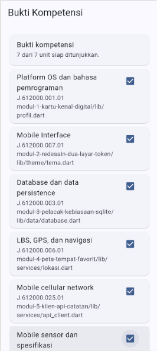

# Modul 8: Latihan Uji Kompetensi dan Pembahasan

Waktu: 15.00 to 17.00 (Hari 2)

## Tujuan Pembelajaran

Setelah modul ini, peserta mampu:

1. Mengerjakan latihan soal teori dan praktik dari setiap unit kompetensi.
2. Membahas jawaban dan memahami kesalahan yang sering terjadi.
3. Menyusun rencana belajar mandiri sebelum uji kompetensi.

## Format Sesi

| Bagian | Waktu | Kegiatan |
|---|---|---|
| Latihan teori | 30 menit | Mengerjakan soal pilihan ganda dan isian |
| Latihan praktik | 45 menit | Menyelesaikan tugas kecil di aplikasi |
| Pembahasan | 30 menit | Membahas jawaban bersama |
| Rencana belajar mandiri | 15 menit | Menyusun daftar materi yang perlu diulang |

## Bagian A: Soal Teori

Jawab singkat dan jelas. Jawaban dibahas pada sesi.

1. Jelaskan perbedaan 4G dan 5G dari sisi kecepatan, latensi, dan kapasitas.
2. Apa fungsi handover pada jaringan seluler?
3. Sebutkan dua contoh sensor yang umum ada pada perangkat Android.
4. Mengapa aplikasi sebaiknya membatalkan langganan sensor saat layar ditutup?
5. Apa perbedaan autentikasi dan otorisasi?
6. Mengapa token login harus disimpan di secure storage, bukan di SharedPreferences?
7. Jelaskan peran TLS dalam HTTPS.
8. Apa perbedaan `ListView.builder` dan `ListView` biasa untuk daftar panjang? (Materi Hari 1, modul 2)
9. Apa fungsi `FutureBuilder` pada aplikasi Flutter? (Materi Hari 1)
10. Mengapa koneksi database SQLite perlu ditutup atau dikelola dengan singleton? (Materi Hari 1, modul 3)

## Bagian B: Latihan Praktik

Kerjakan langsung di proyek `app/`. Tandai setiap tugas yang sudah selesai.

- [ ] Tampilkan jumlah sensor yang tersedia (accelerometer, gyroscope) pada halaman sensor.
- [ ] Tambahkan teks peringatan di halaman jaringan jika jenis koneksi adalah seluler.
- [ ] Tambahkan validasi bahwa judul catatan tidak boleh hanya berisi spasi.
- [ ] Ubah halaman perangkat agar menampilkan versi Android dalam format "Android 14 (API 34)".
- [ ] Tambahkan tombol "Hapus token" di halaman keamanan yang menampilkan pesan konfirmasi.
- [ ] Tulis satu unit test tambahan untuk fungsi `periksaUrlAman`.

## Bagian C: Pembahasan

Setiap soal dibahas dengan pola berikut:

1. Peserta menjawab terlebih dahulu.
2. Fasilitator meminta peserta lain menilai jawaban.
3. Fasilitator menjelaskan jawaban yang tepat dan contoh kesalahan umum.

## Bagian D: Rencana Belajar Mandiri

Isi tabel berikut sebelum uji kompetensi:

| Unit atau topik | Sudah paham | Perlu diulang | Sumber belajar |
|---|---|---|---|
| | | | |
| | | | |
| | | | |

Sumber yang dapat dipakai: dokumentasi resmi Flutter (https://docs.flutter.dev), dokumentasi Dart (https://dart.dev), dan materi di folder `docs/` repositori ini.

## Catatan untuk Fasilitator

- Soal pada bagian A dan B disusun dari modul 1 sampai 7. Sesuaikan jumlah dan bobot soal dengan daftar unit kompetensi resmi yang berlaku.
- Pembahasan bagian C sebaiknya mengutamakan jawaban yang dijelaskan peserta sendiri, bukan hanya jawaban benar.

## Contoh hasil

Tangkapan layar hasil menjalankan proyek modul 8 (sama dengan README proyek dan slide).

