# Setup Android Studio (Emulator) dan Editor untuk Flutter

Panduan ini menyiapkan emulator Android dari Android Studio, lalu menghubungkannya ke VS Code atau Antigravity. Pemasangan Flutter SDK ada di [instalasi Dart dan Flutter](instalasi-dart-flutter.md). Cara menjalankan di HP fisik dan emulator ada di [menjalankan proyek](../../shared/docs/menjalankan-proyek.md).

## 1. Pasang Android Studio dan Android SDK

1. Pasang [Android Studio](https://developer.android.com/studio). Saat pertama dibuka, pilih **Standard** di wizard agar Android SDK ikut terpasang.

   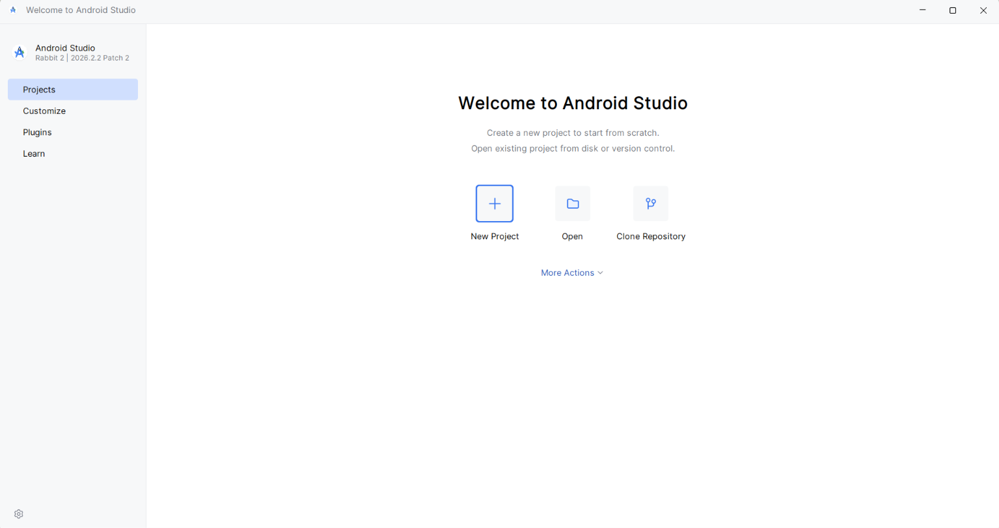

2. Buka **More Actions > SDK Manager**.

   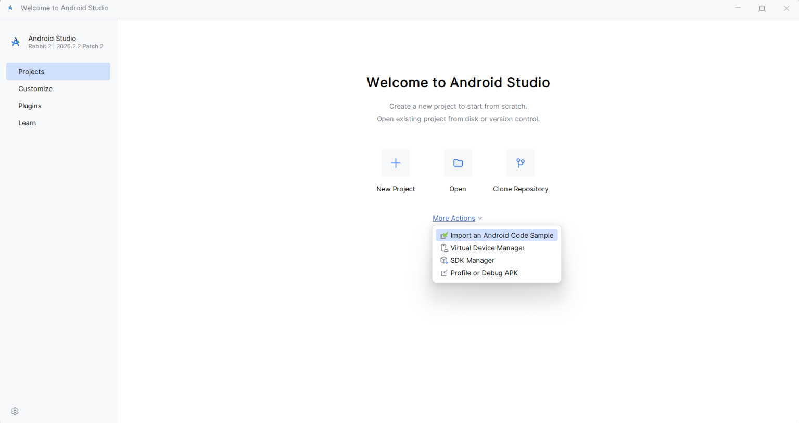

3. Di tab **SDK Platforms**, centang **Android 15 (API 35)** atau **Android 14 (API 34)**.

   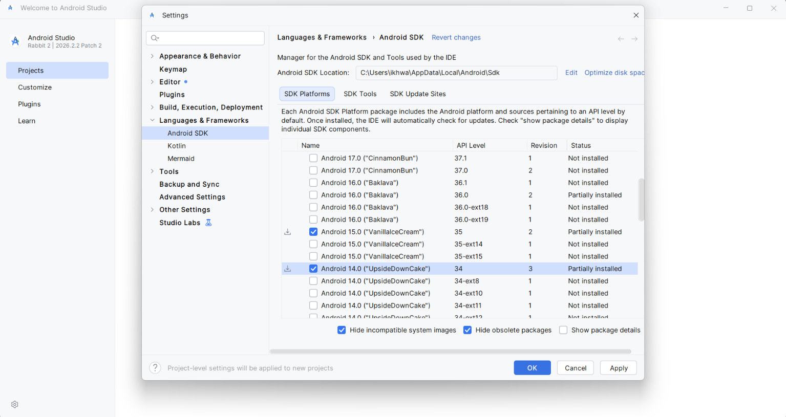

4. Di tab **SDK Tools**, pastikan terpasang:
   - Android SDK Build-Tools
   - Android SDK Command-line Tools (latest)
   - Android Emulator
   - Android SDK Platform-Tools

   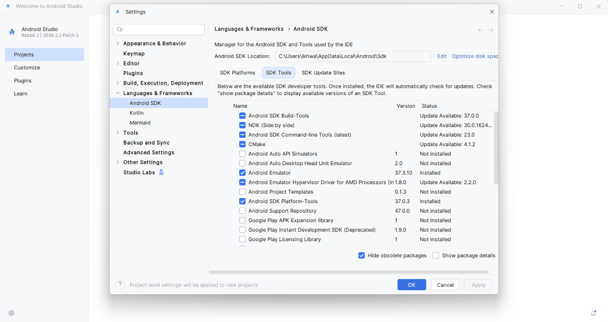

5. Klik **Apply**, setujui lisensi, lalu tunggu unduhan selesai.

   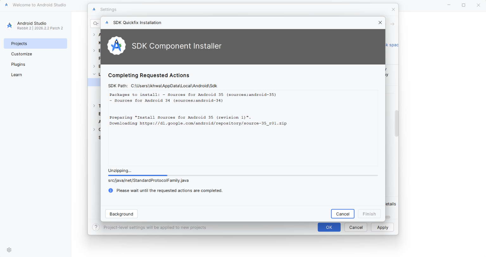

   Setelah muncul tulisan **Done**, klik **Finish**.

   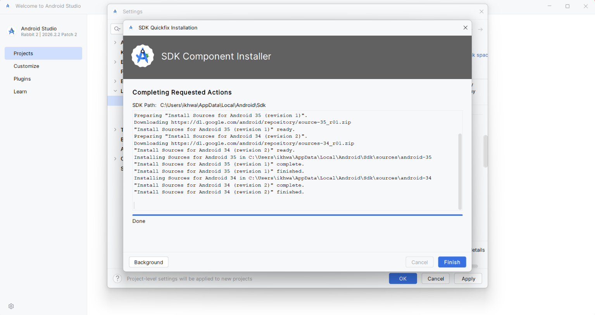

Setelah itu, di terminal jalankan:

```powershell
flutter doctor --android-licenses
flutter doctor
```

Setujui semua lisensi dengan `y`. Pada hasil `flutter doctor`, baris **Android toolchain** harus bertanda centang. Jika Flutter tidak menemukan SDK, jalankan `flutter config --android-sdk "C:\Users\<nama>\AppData\Local\Android\Sdk"` sesuai lokasi di SDK Manager.

## 2. Buat emulator (AVD)

1. Buka **More Actions > Virtual Device Manager**. Daftar masih kosong, klik **Add a new device**.

   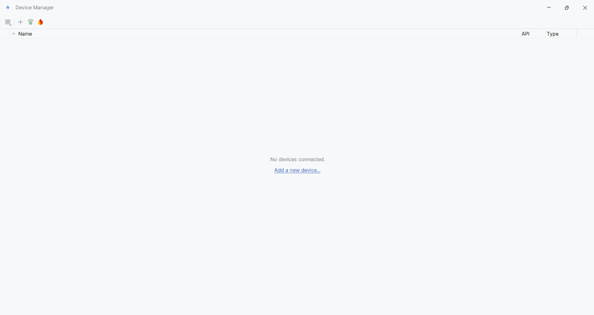

2. Pada **Add Device**, pilih **Phone**, lalu pilih **Pixel 7** dan klik **Next**.

   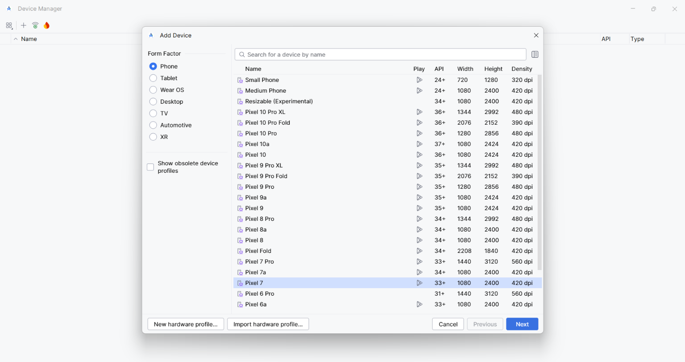

3. Pilih system image **API 35** dengan ABI **x86_64** (Google Play Intel x86_64). Image ini sekitar 1,6 GB. Klik **Download** bila belum ada, lalu **Next** dan **Finish**.

   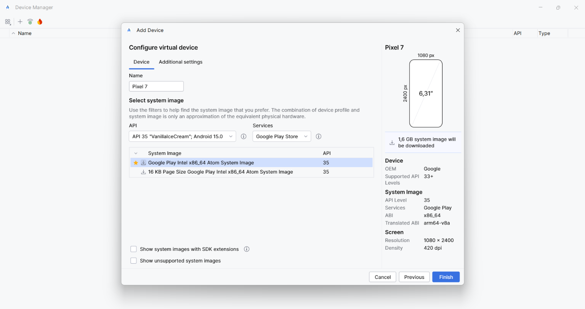

4. Tunggu unduhan selesai. Android Studio mengunduh image ke folder SDK.

   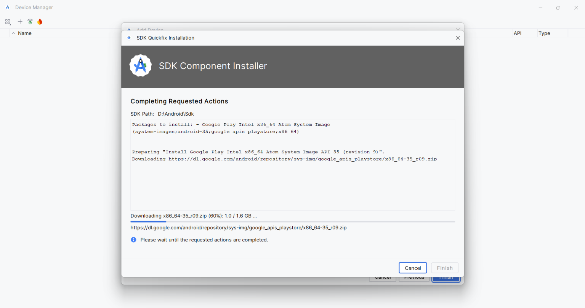

5. Setelah pemasangan selesai, klik **Finish**.

   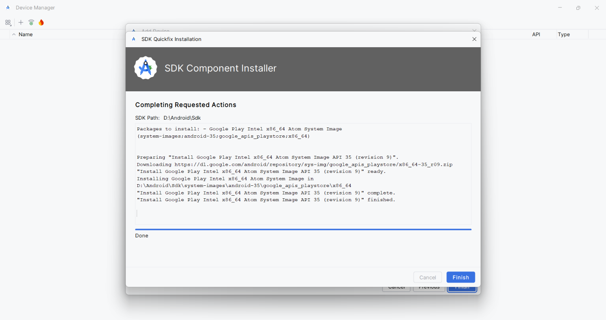

6. Pixel 7 tampil di daftar dengan tipe **Virtual**. Klik ikon **Play** untuk menyalakan emulator, dan tunggu layar beranda Android tampil.

   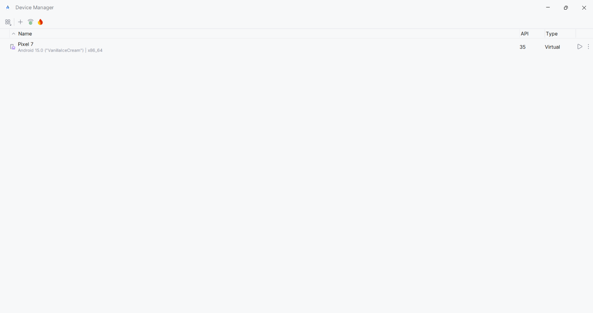

Panduan dalam bentuk slide: [slides/setup-emulator.html](../slides/setup-emulator.html).

Pada Windows, virtualisasi harus aktif di BIOS (Intel VT-x atau AMD-V) dan fitur Hypervisor Platform di Windows Features.

## 3. Pakai VS Code

1. Pasang [VS Code](https://code.visualstudio.com).
2. Buka panel **Extensions** (Ctrl+Shift+X), lalu pasang **Flutter**. Ekstensi **Dart** ikut terpasang otomatis.
3. Buka folder proyek, misalnya `flutter/proyek-modul/modul-1-kartu-kenal-digital`.
4. Pilih perangkat: tekan **Ctrl+Shift+P**, ketik `Flutter: Select Device`, lalu pilih emulator yang sudah menyala atau HP fisik.
5. Jalankan dengan **F5** (Run > Start Debugging) atau **Ctrl+F5** tanpa debugger. Aplikasi akan tampil di emulator.
6. Lihat galat di panel **Problems**. Untuk tes, buka terminal terintegrasi (Ctrl+`) lalu jalankan `flutter test`.

Hot reload dilakukan dengan menekan **r** di terminal debug, atau tombol **Hot Reload** di toolbar Debug.

## 4. Pakai Antigravity

Antigravity dibangun di atas VS Code, jadi alur kerjanya mirip. Cara pastinya bisa berbeda tiap versi, jadi periksa dokumentasi Antigravity bila ada langkah yang tidak cocok.

1. Pasang Antigravity, lalu buka folder proyek.
2. Pasang ekstensi **Flutter** dari panel Extensions. Bila tidak ditemukan di pasar ekstensi Antigravity, lanjutkan dengan langkah terminal di bawah. Perintah Flutter berfungsi di terminal mana pun.
3. Di terminal Antigravity, jalankan:

```powershell
flutter devices
flutter run
```

Bila `flutter devices` belum menampilkan emulator, nyalakan emulator dari Android Studio lebih dulu, lalu ulangi perintah itu.

## 5. Periksa semuanya

Jalankan perintah berikut di folder proyek. Semuanya harus berhasil:

```powershell
flutter doctor
flutter devices
flutter pub get
flutter analyze
flutter test
flutter run
```

## 6. Hubungkan HP Android (real device)

Pakai HP fisik untuk fitur yang tidak ada di emulator, misalnya sensor (modul 6), GPS yang sebenarnya (modul 4 dan capstone), dan jaringan seluler.

### Lewat kabel USB

1. Di HP, buka **Settings > About phone**, lalu ketuk **Build number** tujuh kali.
2. Buka **Settings > Developer options**, lalu aktifkan **USB debugging**.
3. Sambungkan HP ke laptop dengan kabel data. Pilih mode **File transfer** atau **Transfer files** jika HP menanyakannya.
4. Setujui dialog **Allow USB debugging** di HP. Centang **Always allow from this computer** agar tidak ditanya lagi.
5. Di terminal, cek bahwa HP terdeteksi:

```powershell
flutter devices
```

HP harus tampil dengan nama modelnya. Jika belum muncul, pasang USB driver dari merek HP (misalnya Samsung USB Driver), lalu cabut dan sambungkan ulang kabel.

### Lewat Wi-Fi (Android 11 ke atas)

1. HP dan laptop harus memakai Wi-Fi yang sama.
2. Di HP, buka **Developer options > Wireless debugging**, lalu aktifkan.
3. Ketuk **Pair device with pairing code**. Catat alamat IP:port dan kode pairing yang tampil.
4. Di terminal, pasangkan HP. Ganti `IP:PORT` dan `KODE` sesuai layar HP:

```powershell
adb pair IP:PORT
adb connect IP:PORT
```

5. Cek lagi dengan `flutter devices`. Port untuk `adb connect` berbeda dengan port pairing, jadi pakai port yang tertera di layar **Wireless debugging** utama.

### Jalankan ke HP

Di folder proyek, jalankan:

```powershell
flutter run
```

Jika ada lebih dari satu perangkat, pilih dengan `flutter run -d <id>`. ID diambil dari hasil `flutter devices`.

Catatan:
- HP perlu internet untuk proyek yang memakai MockAPI (modul 5 dan 7, serta capstone-contoh).
- Izin lokasi dan internet harus diberikan saat aplikasi pertama dijalankan.
- Jika muncul galat `INSTALL_FAILED_USER_RESTRICTED`, aktifkan **Install via USB** di Developer options.

## 7. Jalankan di web

Flutter bisa menjalankan aplikasi di browser, tanpa emulator. Chrome harus terpasang.

```powershell
flutter devices
flutter run -d chrome
```

Untuk browser lain, pakai server web lokal:

```powershell
flutter run -d web-server --web-port 8080
```

Lalu buka `http://localhost:8080` di browser.

Tidak semua proyek mendukung web. Proyek yang memakai SQLite (`sqflite`), GPS, atau sensor tidak bisa berjalan di browser. Cek catatan di README tiap modul.

Catatan error lengkap: [catatan error umum](catatan-error-umum.md).

## Masalah umum

| Gejala | Yang perlu dicek |
|---|---|
| `flutter doctor` menandai Android toolchain | Jalankan `flutter doctor --android-licenses`, lalu periksa path SDK dengan `flutter config` |
| Emulator tidak muncul di `flutter devices` | Nyalakan emulator dulu, lalu ulangi `flutter devices` |
| Emulator gagal menyala atau sangat lambat | Aktifkan virtualisasi di BIOS dan Hypervisor Platform, pakai image x86_64 |
| Ekstensi Flutter tidak bisa dipasang di Antigravity | Pakai terminal untuk `flutter run` dan `flutter test` |
| Hot reload tidak berjalan | Hentikan dan jalankan ulang dengan `flutter run` |
