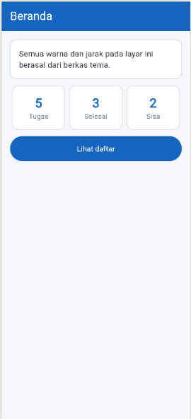
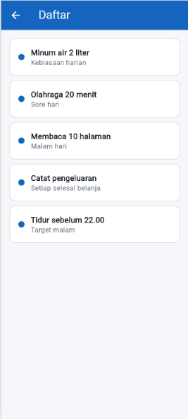

# Modul 2: Redesain Dua Layar dengan Token (Flutter)

Proyek kecil untuk Modul 2 (desain). Brief: [shared/docs/proyek/modul-2-redesain-dua-layar-dengan-token.md](../../../shared/docs/proyek/modul-2-redesain-dua-layar-dengan-token.md).

## Demo





## Sudah punya proyek? Pasang Flutter lalu jalankan

Pakai langkah ini bila folder proyek sudah ada (berisi `lib/`, `test/`, dan `pubspec.yaml`) dan Anda hanya perlu menyiapkan Flutter di komputer. Tidak perlu membuat proyek dari awal.

1. Pastikan Flutter terpasang: `flutter doctor`. Jika belum, ikuti [instalasi Dart dan Flutter](../../../flutter/docs/instalasi-dart-flutter.md).
2. Masuk ke folder proyek.
3. Tambahkan folder Android yang belum ada. Lewati langkah ini jika folder `android/` sudah ada, lalu lanjut ke langkah 4:

```bash
flutter create . --platforms android
```

File yang sudah ada (`lib/`, `test/`, `pubspec.yaml`) tidak ditimpa. Periksa dengan `git status` bila ragu.

4. Unduh paket: `flutter pub get`.
5. Cek perangkat: `flutter devices`. Pakai HP fisik dengan USB debugging, atau emulator yang sudah menyala.
6. Jalankan: `flutter run`. Bila ada lebih dari satu perangkat, pilih dengan `flutter run -d <id>`.

Jika muncul galat setelah mengubah dependensi, jalankan `flutter clean`, lalu ulangi `flutter pub get` dan `flutter run`.

Jalankan di web (Chrome):

```bash
flutter run -d chrome
```

Untuk membuat berkas web statis, jalankan `flutter build web`. Hasilnya ada di `build/web`. Perintah ini memerlukan folder `web/`, yang sudah ada di proyek ini.

Panduan HP dan emulator Android Studio: [menjalankan proyek](../../../shared/docs/menjalankan-proyek.md).

```bash
flutter pub get
flutter run
flutter test
flutter analyze
```

- Semua warna dan jarak ada di `lib/theme/tema.dart`. Ubah satu nilai (misalnya `utama`), lalu lihat kedua layar berubah.
- Tes memastikan tidak ada kode warna mentah di luar berkas tema, dan kontras teks memenuhi 4,5.
