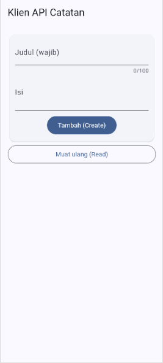
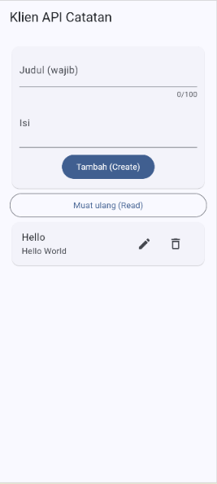
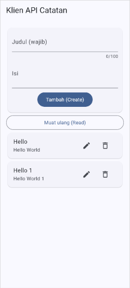
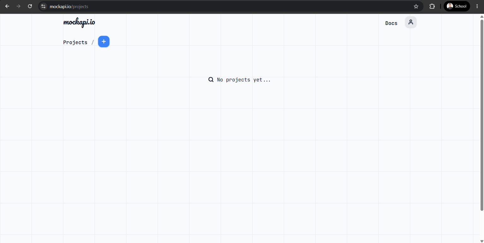
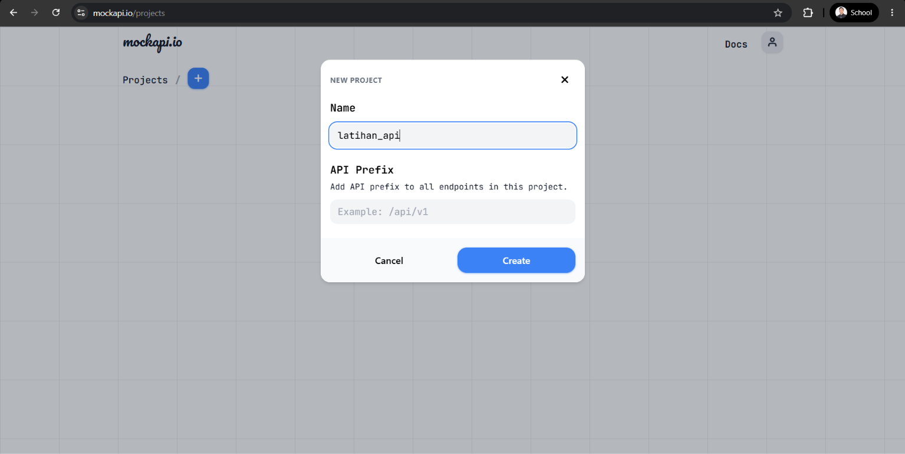
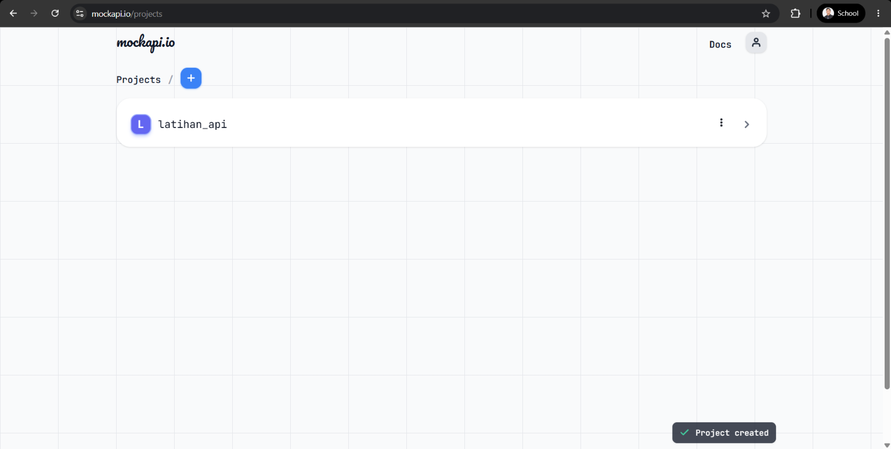
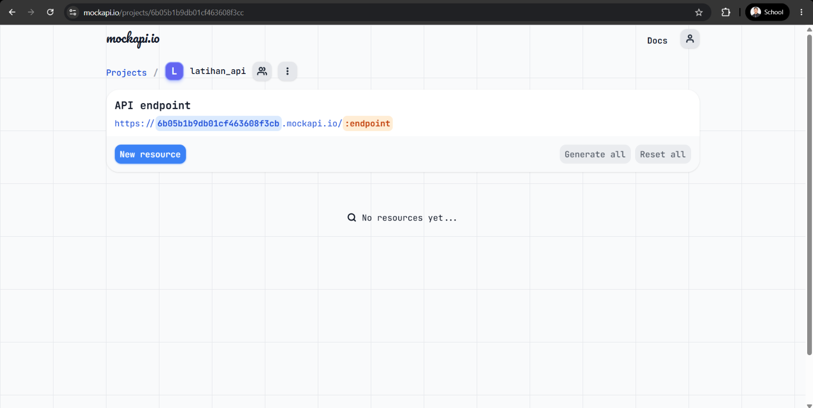
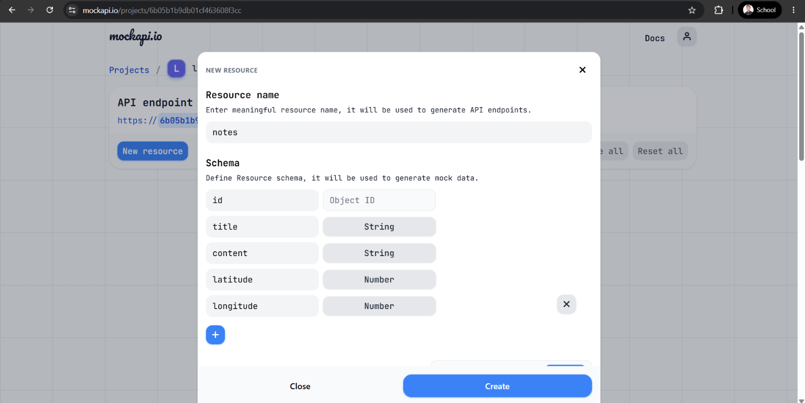
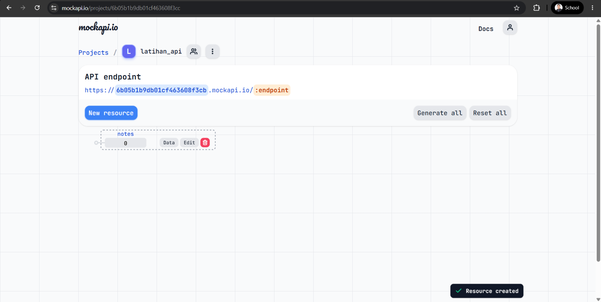
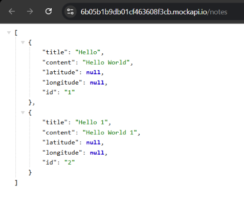

# Modul 5: Klien API Catatan (Flutter)

Proyek kecil untuk Modul 5 (API dan menghubungkan aplikasi mobile). Brief: [shared/docs/proyek/modul-5-klien-api-catatan.md](../../../shared/docs/proyek/modul-5-klien-api-catatan.md).

Latihan ini memakai [MockAPI](https://mockapi.io) untuk CRUD. Tidak perlu server lokal dan tidak ada login.

## Siapkan MockAPI (sekali)

1. Buat akun dan project di mockapi.io.
2. Buat resource bernama `notes`. Field yang dipakai: `title` (teks), `content` (teks), `latitude` (angka, boleh kosong), `longitude` (angka, boleh kosong).
3. Salin alamat resource, misalnya `https://64f0a1b2c3d4e5f6a7b8c9d0.mockapi.io/api/v1/notes`.
4. Ganti `GANTI-ID` di `lib/config.dart` dengan ID project Anda. Tanpa langkah ini aplikasi tidak bisa mengambil data.

## Demo





















## Sudah punya proyek? Pasang Flutter lalu jalankan

Pakai langkah ini bila folder proyek sudah ada (berisi `lib/`, `test/`, dan `pubspec.yaml`) dan Anda hanya perlu menyiapkan Flutter di komputer. Tidak perlu membuat proyek dari awal.

1. Pastikan Flutter terpasang: `flutter doctor`. Jika belum, ikuti [instalasi Dart dan Flutter](../../../flutter/docs/instalasi-dart-flutter.md).
2. Masuk ke folder proyek.
3. Tambahkan folder Android yang belum ada. Lewati langkah ini jika folder `android/` sudah ada, lalu lanjut ke langkah 4:

```bash
flutter create . --platforms android
```

File yang sudah ada (`lib/`, `test/`, `pubspec.yaml`) tidak ditimpa. Periksa dengan `git status` bila ragu.

Proyek ini memanggil API lewat internet. Tambahkan izin INTERNET di `android/app/src/main/AndroidManifest.xml` di dalam `<manifest>`, sebelum `<application>`:

```xml
<uses-permission android:name="android.permission.INTERNET" />
```

4. Unduh paket: `flutter pub get`.
5. Cek perangkat: `flutter devices`. Pakai HP fisik dengan USB debugging, atau emulator yang sudah menyala.
6. Jalankan: `flutter run`. Bila ada lebih dari satu perangkat, pilih dengan `flutter run -d <id>`.

Jika muncul galat setelah mengubah dependensi, jalankan `flutter clean`, lalu ulangi `flutter pub get` dan `flutter run`.

Jalankan di web (Chrome):

```bash
flutter run -d chrome
```

Untuk membuat berkas web statis, jalankan `flutter build web`. Hasilnya ada di `build/web`. Perintah ini memerlukan folder `web/`, yang sudah ada di proyek ini.

Panduan HP dan emulator Android Studio: [menjalankan proyek](../../../shared/docs/menjalankan-proyek.md).

## Menjalankan

```bash
flutter pub get
flutter run
flutter test
flutter analyze
```

Panduan lengkap untuk HP fisik dan emulator Android Studio: [shared/docs/menjalankan-proyek.md](../../../shared/docs/menjalankan-proyek.md).

## Yang dilatih

- **Read:** tombol "Muat ulang" mengambil daftar dengan `GET`.
- **Create:** isi judul lalu tekan "Tambah" untuk `POST`.
- **Update:** tekan ikon ubah pada catatan, ubah isinya, lalu simpan untuk `PUT`.
- **Delete:** tekan ikon hapus untuk `DELETE`.
- Galat ditampilkan dengan pesan yang ramah lewat `lib/services/pesan_error.dart`.

Klien CRUD ada di `lib/services/api_client.dart`. Tes ada di `test/api_client_test.dart`.

Kendala umum saat menjalankan: [catatan error umum](../../docs/catatan-error-umum.md).

