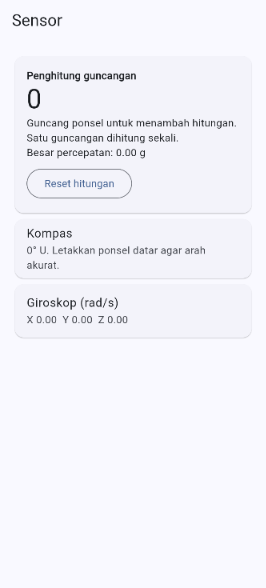

# Modul 6: Penghitung Guncangan dan Kompas (Flutter)

Proyek kecil untuk Modul 6 (mobile sensor dan spesifikasi perangkat). Brief: [shared/docs/proyek/modul-6-penghitung-guncangan-dan-kompas.md](../../../shared/docs/proyek/modul-6-penghitung-guncangan-dan-kompas.md).

## Demo



## Sudah punya proyek? Pasang Flutter lalu jalankan

Pakai langkah ini bila folder proyek sudah ada (berisi `lib/`, `test/`, dan `pubspec.yaml`) dan Anda hanya perlu menyiapkan Flutter di komputer. Tidak perlu membuat proyek dari awal.

1. Pastikan Flutter terpasang: `flutter doctor`. Jika belum, ikuti [instalasi Dart dan Flutter](../../../flutter/docs/instalasi-dart-flutter.md).
2. Masuk ke folder proyek.
3. Tambahkan folder Android yang belum ada. Lewati langkah ini jika folder `android/` sudah ada, lalu lanjut ke langkah 4:

```bash
flutter create . --platforms android
```

File yang sudah ada (`lib/`, `test/`, `pubspec.yaml`) tidak ditimpa. Periksa dengan `git status` bila ragu.

4. Unduh paket: `flutter pub get`.
5. Cek perangkat: `flutter devices`. Pakai HP fisik dengan USB debugging, atau emulator yang sudah menyala.
6. Jalankan: `flutter run`. Bila ada lebih dari satu perangkat, pilih dengan `flutter run -d <id>`.

Jika muncul galat setelah mengubah dependensi, jalankan `flutter clean`, lalu ulangi `flutter pub get` dan `flutter run`.

Versi web tidak didukung untuk proyek ini karena memakai paket native (SQLite, GPS, atau sensor). Jalankan di Android (lihat langkah di atas).

Panduan HP dan emulator Android Studio: [menjalankan proyek](../../../shared/docs/menjalankan-proyek.md).

```bash
flutter pub get
flutter run        # sensor berfungsi di perangkat fisik
flutter test
flutter analyze
```

- Logika guncangan, kompas, dan mata angin ada di `lib/services/sensor_math.dart` dan diuji tanpa perangkat.
- Akselerometer memberi m/s². Dibagi `gravitasi` agar nilainya dalam g.
- Langganan sensor dihentikan di `dispose()`.

Kendala umum saat menjalankan: [catatan error umum](../../docs/catatan-error-umum.md).

