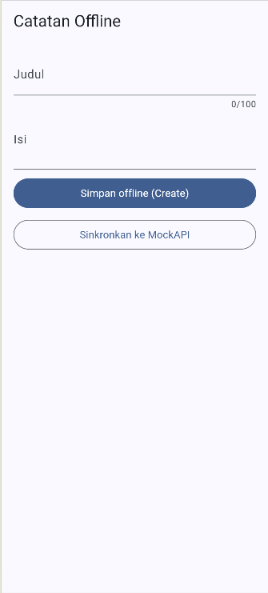

# Modul 7: Sinkronisasi Offline-First (Flutter)

Proyek kecil untuk Modul 7 (API lanjutan dan sinkronisasi). Brief: [shared/docs/proyek/modul-7-sinkronisasi-offline-first.md](../../../shared/docs/proyek/modul-7-sinkronisasi-offline-first.md).

Latihan ini memakai [MockAPI](https://mockapi.io) sebagai server. Tidak ada login.

## Siapkan MockAPI (sekali)

1. Buat akun dan project di mockapi.io.
2. Buat resource bernama `notes` dengan field `title`, `content`, `latitude`, dan `longitude`.
3. Ganti `GANTI-ID` di `lib/config.dart` dengan ID project Anda.

## Demo



## Sudah punya proyek? Pasang Flutter lalu jalankan

Pakai langkah ini bila folder proyek sudah ada (berisi `lib/`, `test/`, dan `pubspec.yaml`) dan Anda hanya perlu menyiapkan Flutter di komputer. Tidak perlu membuat proyek dari awal.

1. Pastikan Flutter terpasang: `flutter doctor`. Jika belum, ikuti [instalasi Dart dan Flutter](../../../flutter/docs/instalasi-dart-flutter.md).
2. Masuk ke folder proyek.
3. Tambahkan folder Android yang belum ada. Lewati langkah ini jika folder `android/` sudah ada, lalu lanjut ke langkah 4:

```bash
flutter create . --platforms android
```

File yang sudah ada (`lib/`, `test/`, `pubspec.yaml`) tidak ditimpa. Periksa dengan `git status` bila ragu.

Proyek ini memanggil API lewat internet. Tambahkan izin INTERNET di `android/app/src/main/AndroidManifest.xml` di dalam `<manifest>`, sebelum `<application>`:

```xml
<uses-permission android:name="android.permission.INTERNET" />
```

4. Unduh paket: `flutter pub get`.
5. Cek perangkat: `flutter devices`. Pakai HP fisik dengan USB debugging, atau emulator yang sudah menyala.
6. Jalankan: `flutter run`. Bila ada lebih dari satu perangkat, pilih dengan `flutter run -d <id>`.

Jika muncul galat setelah mengubah dependensi, jalankan `flutter clean`, lalu ulangi `flutter pub get` dan `flutter run`.

Versi web tidak didukung untuk proyek ini karena memakai paket native (SQLite, GPS, atau sensor). Jalankan di Android (lihat langkah di atas).

Panduan HP dan emulator Android Studio: [menjalankan proyek](../../../shared/docs/menjalankan-proyek.md).

## Menjalankan

```bash
flutter pub get
flutter run
flutter test
flutter analyze
```

Panduan lengkap untuk HP fisik dan emulator Android Studio: [shared/docs/menjalankan-proyek.md](../../../shared/docs/menjalankan-proyek.md).

## Yang dilatih

- Catatan disimpan lokal di SQLite dengan status `PENDING`. Setelah sinkron, status menjadi `SYNCED`.
- Catatan baru dikirim dengan `POST`. Catatan yang sudah punya `server_id` dikirim dengan `PUT`.
- Catatan dari MockAPI diambil dengan `GET` dan disimpan sebagai `SYNCED`.
- Satu kegagalan tidak menghentikan catatan lain. Hasilnya dilaporkan: terkirim, diterima, dan gagal.

Logika sinkronisasi ada di `lib/services/sync_service.dart`. Tes memakai penyimpanan dan API tiruan di `test/sync_test.dart`.

Kendala umum saat menjalankan: [catatan error umum](../../docs/catatan-error-umum.md).

