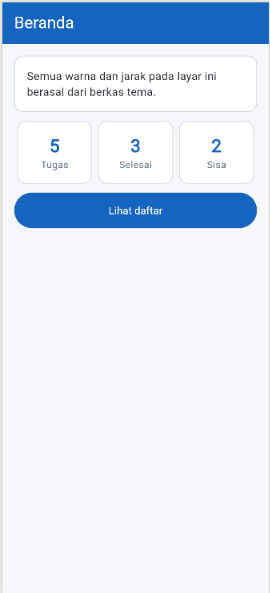
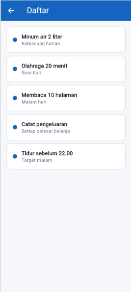

# Proyek Modul 2: Redesain Dua Layar dengan Token

Modul 2: Desain dengan Figma dan Stitch, Gaya, dan Implementasi dengan AI · Estimasi 60 menit · Unit BNSP J.612000.007.01

by [Muhammad Ikhwan Fathulloh](https://one.nocturnailed.com/)

## Skenario

Ambil rancangan dua layar (Beranda dan Daftar) dari Stitch atau Figma, jadikan variable menjadi token, lalu implementasikan di aplikasi. Boleh meminta bantuan AI, tetapi hasilnya harus Anda tinjau.

## Yang harus dibuat

- [ ] Rancangan dua layar di Figma (boleh dimulai dari Stitch atau berkas contoh pelatihan).
- [ ] Minimal 8 variable di Figma: warna, spasi, dan radius.
- [ ] Berkas tema di kode dengan nama yang sama dengan variable Figma.
- [ ] Dua layar di aplikasi memakai tema, tanpa angka warna atau jarak mentah di komponen.
- [ ] Tangkapan layar perbandingan: desain di samping hasil aplikasi.
- [ ] Catatan singkat prompt AI yang dipakai dan satu hal yang Anda koreksi dari hasil AI.

## Kriteria penerimaan

Proyek dianggap selesai bila semua ini dapat didemonstrasikan:

- Mengubah satu nilai pada berkas tema mengubah tampilan di kedua layar.
- Target sentuh tombol minimal 48 dp dan kontras teks mudah dibaca.
- Tidak ada kode warna heksadesimal di luar berkas tema (cari dengan pencarian teks).

## Petunjuk React Native

- `src/theme.ts` dan `src/ui.ts` (lihat Modul 2).
- Pencarian cepat: `grep -rn "#[0-9a-fA-F]\{6\}" app src` hanya boleh menemukan `theme.ts`.

## Petunjuk Flutter

- `lib/theme/tema.dart` dan `ThemeData` (lihat `flutter/app`).
- Cari `Color(0x` di luar berkas tema.

## Tantangan tambahan

- Tambah tema gelap dengan token kedua.
- Buat tiga gaya (Material, minimal, gelap) yang dapat dipilih pengguna.

## Rubrik (100 poin)

| Aspek | Poin |
|---|---|
| Rancangan dan variable Figma | 25 |
| Berkas tema sama dengan variable | 25 |
| Dua layar sesuai rancangan | 25 |
| Aksesibilitas (sentuh, kontras) | 10 |
| Peninjauan hasil AI | 15 |
| **Total** | **100** |

## Hubungan dengan proyek akhir

Hasil proyek ini dapat dipakai sebagai bagian proyek akhir. Lihat [proyek akhir](capstone.md) dan matriks fitur di dalamnya.

## Contoh hasil (Flutter)

Tangkapan layar hasil menjalankan proyek modul 2 (sama dengan README proyek dan slide).

