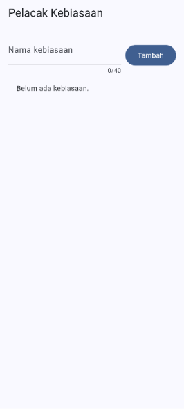
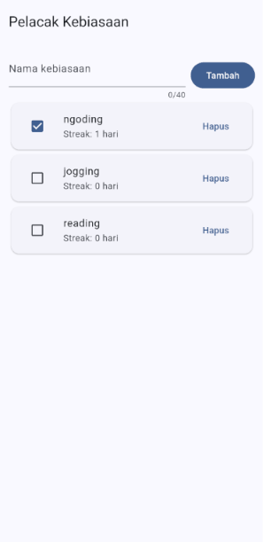
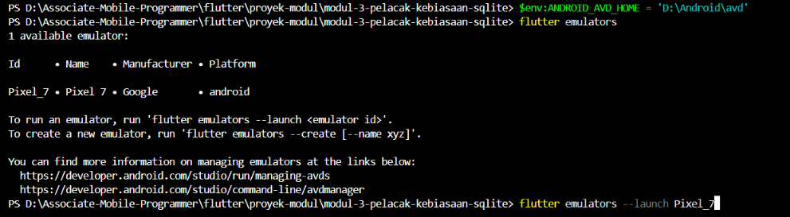
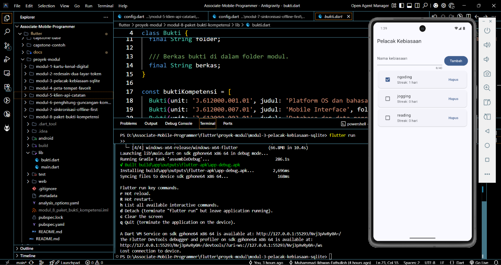

# Proyek Modul 3: Pelacak Kebiasaan dengan SQLite

Modul 3: SQLite, MySQL, dan Data Persistence · Estimasi 75 menit · Unit BNSP J.612000.003.01

by [Muhammad Ikhwan Fathulloh](https://one.nocturnailed.com/)

## Skenario

Buat pelacak kebiasaan harian (minum air, olahraga, membaca). Pengguna menambah kebiasaan dan mencentang kebiasaan yang selesai hari ini. Data harus tetap ada setelah aplikasi ditutup.

## Yang harus dibuat

- [ ] Dua tabel: `habits` (id, nama, dibuat) dan `logs` (id, habit_id, tanggal) dengan kunci asing.
- [ ] Lapisan repository terpisah dari tampilan: tambah, baca, ubah, hapus kebiasaan, serta catat dan batalkan centang.
- [ ] Satu migrasi: tambahkan kolom `warna` pada `habits` tanpa menghapus data lama.
- [ ] Layar daftar dengan jumlah hari berturut-turut (streak) per kebiasaan.
- [ ] Jawaban tertulis tiga kalimat: mengapa aplikasi ini memakai SQLite dan bukan MySQL langsung?

## Kriteria penerimaan

Proyek dianggap selesai bila semua ini dapat didemonstrasikan:

- Tutup aplikasi sepenuhnya lalu buka lagi: data tetap ada.
- Menghapus kebiasaan ikut menghapus lognya (kunci asing).
- Fungsi `hitungStreak(tanggal[])` murni dan diuji untuk: kosong, berurutan, ada jeda, dan tanggal ganda.
- Semua kueri memakai parameter, bukan penggabungan teks.

## Petunjuk React Native

- `expo-sqlite` (API async), buka basis data sekali di `src/data/database.ts`.
- Migrasi lewat `PRAGMA user_version`.

## Petunjuk Flutter

- `sqflite` dengan `onUpgrade` dan `version` dinaikkan.
- `PRAGMA foreign_keys = ON` di `onConfigure`.

## Tantangan tambahan

- Statistik 7 hari terakhir.
- Ekspor data ke teks (CSV).

## Rubrik (100 poin)

| Aspek | Poin |
|---|---|
| Skema dan kunci asing | 20 |
| Repository terpisah dari tampilan | 20 |
| Migrasi tanpa kehilangan data | 15 |
| Streak dan tes | 25 |
| Jawaban SQLite vs MySQL | 10 |
| Data bertahan | 10 |
| **Total** | **100** |

## Hubungan dengan proyek akhir

Hasil proyek ini dapat dipakai sebagai bagian proyek akhir. Lihat [proyek akhir](capstone.md) dan matriks fitur di dalamnya.

## Contoh hasil (Flutter)

Tangkapan layar hasil menjalankan proyek modul 3 (sama dengan README proyek dan slide).

