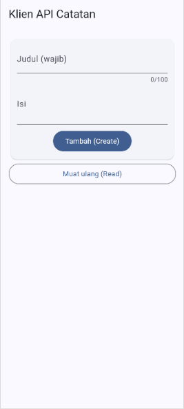
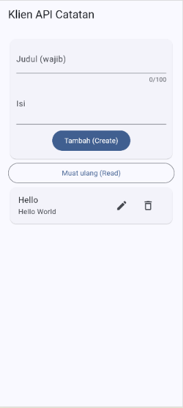
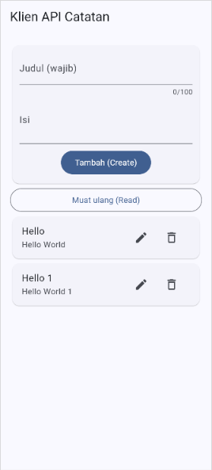
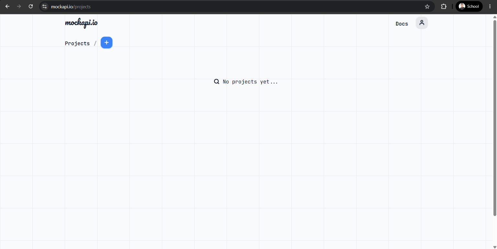
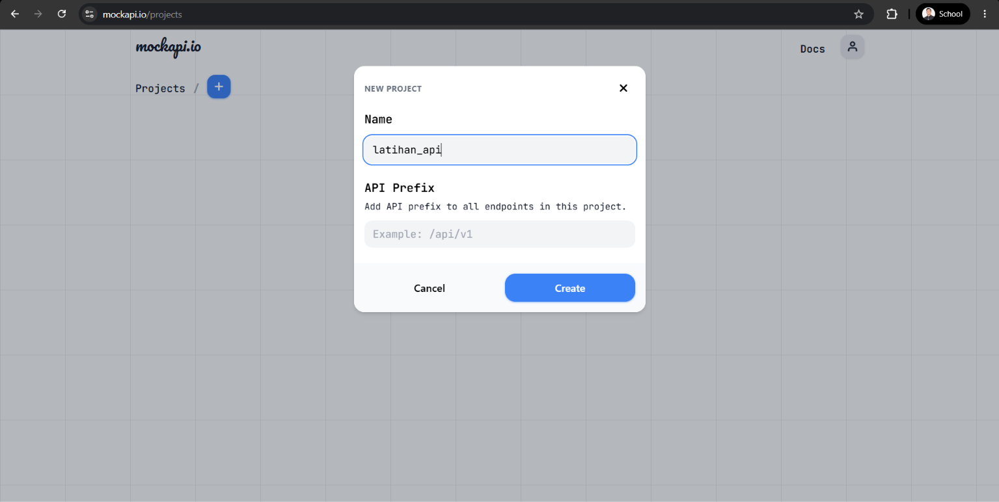
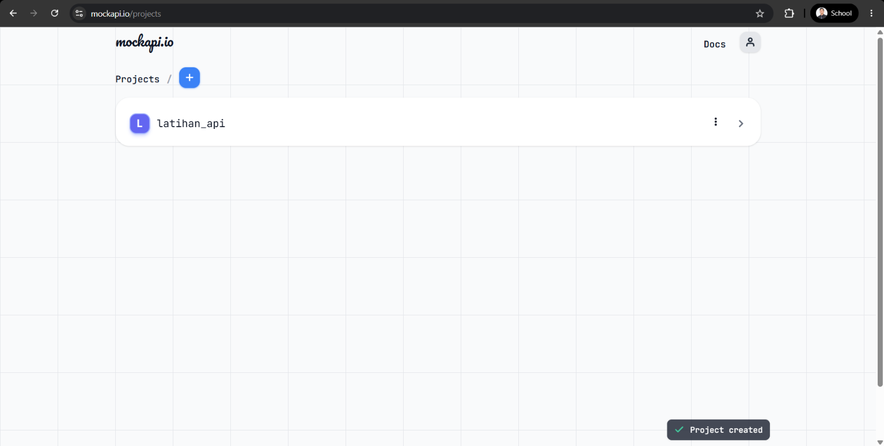
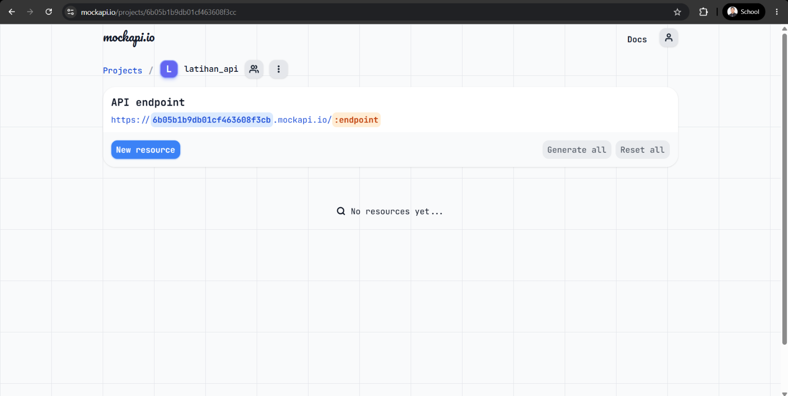
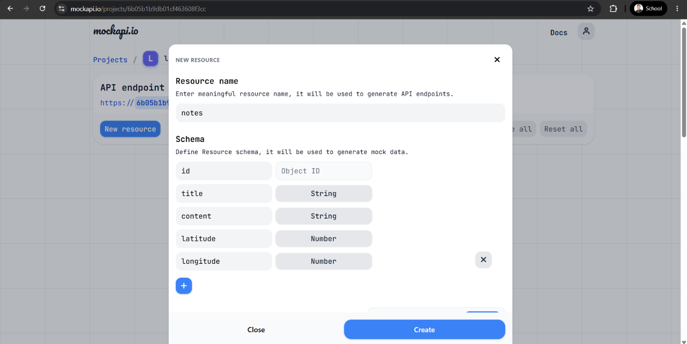
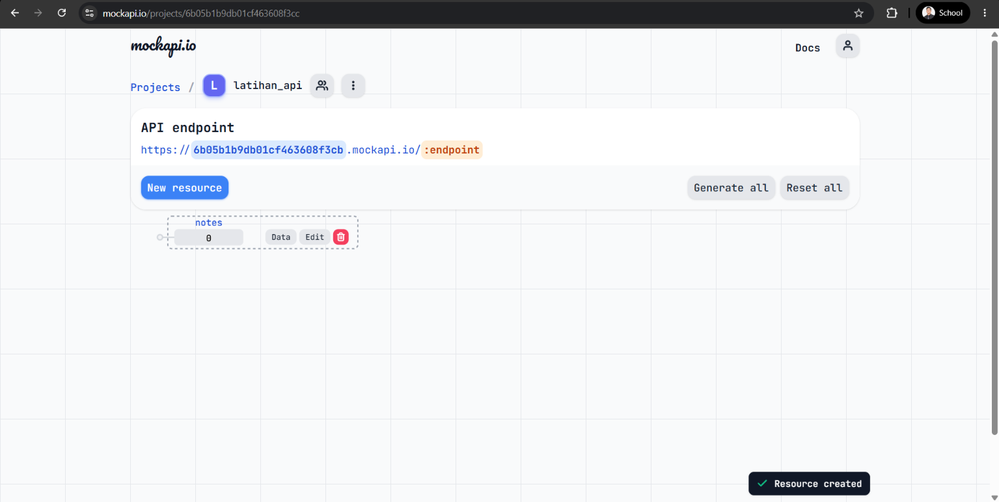
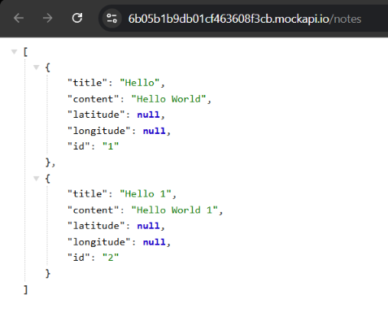

# Proyek Modul 5: Klien API Catatan

Modul 5: API dan Menghubungkan Aplikasi Mobile · Estimasi 60 menit · Unit BNSP J.612000.025.01

by [Muhammad Ikhwan Fathulloh](https://one.nocturnailed.com/)

## Skenario

Hubungkan aplikasi ke server latihan (`shared/server`). Pengguna login, melihat daftar catatan dari server, dan membuat catatan baru. Kesalahan server ditampilkan dengan pesan yang ramah.

## Yang harus dibuat

- [ ] Server latihan berjalan (`npm start`) dan dapat dijangkau dari emulator (`10.0.2.2`) atau ponsel (IP komputer).
- [ ] Klien API terpisah dari tampilan: `login`, `daftarCatatan`, `buatCatatan`.
- [ ] Header `Authorization: Bearer <token>` dikirim pada rute catatan.
- [ ] Pesan error dari server (`error`) ditampilkan, bukan teks teknis.
- [ ] Batas waktu permintaan (timeout) dan penanganan server mati.
- [ ] Minimal 4 tes klien dengan `fetch` atau `http.Client` palsu.

## Kriteria penerimaan

Proyek dianggap selesai bila semua ini dapat didemonstrasikan:

- Login dengan kata sandi salah menampilkan pesan dari server (status 401).
- Judul kosong ditolak server (400) dan pesannya tampil di aplikasi.
- Matikan server: aplikasi menampilkan pesan, tidak macet atau layar putih.
- Status 204 tidak menyebabkan error pembacaan JSON.

## Petunjuk React Native

- `src/services/httpsService.ts` (`requestJson`) dan `apiClient.ts`.
- Tes dengan `fetchFn` palsu seperti `__tests__/api.test.ts`.

## Petunjuk Flutter

- `lib/services/api_client.dart` dan `MockClient` dari `package:http/testing.dart`.

## Tantangan tambahan

- Tampilkan indikator memuat.
- Coba ulang otomatis satu kali bila jaringan gagal.

## Rubrik (100 poin)

| Aspek | Poin |
|---|---|
| Klien API terpisah | 20 |
| Token pada permintaan | 15 |
| Penanganan error dan timeout | 25 |
| Tes klien | 25 |
| Pesan ramah pengguna | 15 |
| **Total** | **100** |

## Hubungan dengan proyek akhir

Hasil proyek ini dapat dipakai sebagai bagian proyek akhir. Lihat [proyek akhir](capstone.md) dan matriks fitur di dalamnya.

## Contoh hasil (Flutter)

Tangkapan layar hasil menjalankan proyek modul 5 (sama dengan README proyek dan slide).

