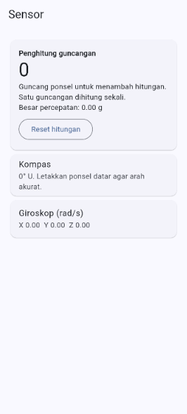

# Proyek Modul 6: Penghitung Guncangan dan Kompas

Modul 6: Mobile Sensor dan Spesifikasi Perangkat · Estimasi 60 menit · Unit BNSP J.612000.022.01

by [Muhammad Ikhwan Fathulloh](https://one.nocturnailed.com/)

## Skenario

Buat alat kecil yang membaca sensor: menghitung berapa kali ponsel diguncang, menampilkan arah kompas, dan menampilkan kecepatan putar. Fokus pada fungsi perhitungan yang bisa diuji.

## Yang harus dibuat

- [ ] Akselerometer: deteksi guncangan bila besar vektor melewati ambang, dengan jeda agar satu guncangan tidak dihitung berkali-kali.
- [ ] Magnetometer: arah dalam derajat dan mata angin (U, TL, T, TG, S, BD, B, BL).
- [ ] Giroskop: tampilkan kecepatan putar tiga sumbu.
- [ ] Berhenti membaca sensor saat halaman ditutup.
- [ ] Fungsi perhitungan murni dan diuji tanpa perangkat.

## Kriteria penerimaan

Proyek dianggap selesai bila semua ini dapat didemonstrasikan:

- Diam di meja: tidak ada guncangan terhitung.
- `terdeteksiGuncangan` benar untuk vektor di bawah, tepat di, dan di atas ambang.
- `mataAngin(0)` bernilai U dan `mataAngin(90)` bernilai T (sesuai definisi yang Anda tulis).
- Langganan sensor dihentikan (periksa tidak ada pembaruan setelah keluar halaman).

## Petunjuk React Native

- `expo-sensors`, `src/services/sensorMath.ts` dan `useEffect` dengan cleanup `remove()`.
- Perhatikan satuan: akselerometer dalam g.

## Petunjuk Flutter

- `sensors_plus` (satuan m/s², bagi 9,80665 untuk g).
- Batalkan `StreamSubscription` di `dispose()`.

## Tantangan tambahan

- Tambah "rekor guncangan" yang tersimpan di SQLite.
- Perbaiki kompas dengan menyaring noise (rata-rata bergerak).

## Rubrik (100 poin)

| Aspek | Poin |
|---|---|
| Deteksi guncangan dengan jeda | 25 |
| Kompas dan mata angin | 20 |
| Giroskop | 10 |
| Langganan dihentikan | 15 |
| Tes fungsi murni | 30 |
| **Total** | **100** |

## Hubungan dengan proyek akhir

Hasil proyek ini dapat dipakai sebagai bagian proyek akhir. Lihat [proyek akhir](capstone.md) dan matriks fitur di dalamnya.

## Contoh hasil (Flutter)

Tangkapan layar hasil menjalankan proyek modul 6 (sama dengan README proyek dan slide).

